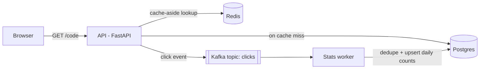

# LinkPulse

A URL shortener with click analytics, built as a hands-on project for production backend engineering: a Python API, event-driven processing with Kafka, caching and rate limiting with Redis, containers, Kubernetes, and a CI/CD pipeline that deploys every merge to AWS.

It is small enough to read in an afternoon and complete enough to show how the pieces of a real backend fit together.

## What it does

- `POST /links` turns a long URL into a short code.
- `GET /{code}` redirects the visitor (HTTP 307) and records the click.
- `GET /links/{code}/stats` returns total and per-day click counts.

## Architecture



| Part | Role |
| --- | --- |
| API (FastAPI) | Creates links, serves redirects, publishes click events |
| Postgres | Source of truth for links and click counts (RDS on AWS) |
| Redis | Caches redirects and holds per-IP rate-limit counters |
| Kafka | Ordered log of click events, so redirects never wait on analytics |
| Worker | Consumes events in batches and updates daily counts |

A click is answered in milliseconds and counted about a second later. Click processing is at-least-once with an idempotent consumer: each event ID is recorded in the same transaction as the count update, and Kafka offsets are committed only after that transaction. Replaying the whole topic does not change the counts.

More detail: [docs/architecture.md](docs/architecture.md).

## Quick start (local)

Requirements: Docker Desktop.

```bash
docker compose up --build
```

Then open http://localhost:8000/docs, create a link with `POST /links`, open the `short_url` it returns, and check `/links/{code}/stats`.

To deploy your own copy to AWS, follow [docs/deploy-to-aws.md](docs/deploy-to-aws.md). Without AWS, the pipeline still runs lint and tests.

## Run the tests

```bash
python3.12 -m venv .venv && source .venv/bin/activate
pip install -r requirements-dev.txt
docker compose up -d postgres      # tests use the linkpulse_test database
pytest -v
ruff check . && ruff format --check .
```

## Tech stack

Python 3.12, FastAPI, Pydantic, SQLAlchemy 2, Alembic, PostgreSQL 17, Redis 7, Apache Kafka (KRaft), confluent-kafka, pytest, ruff, Docker, Docker Compose, Kubernetes (kind locally, k3s on AWS), Kustomize, Traefik, GitLab CI, AWS (ECR, EC2, RDS, IAM).

## CI/CD

Every merge request runs lint and tests against a real Postgres. Once the AWS variables are configured (see [docs/deploy-to-aws.md](docs/deploy-to-aws.md)), every merge to `main` also:

1. builds an image tagged with the commit SHA and pushes it to ECR,
2. runs database migrations as a Kubernetes Job,
3. performs a zero-downtime rolling update,
4. smoke-tests `/health` on the public endpoint.

The pipeline is GitLab CI (`.gitlab-ci.yml`). To use it, import this repository into a GitLab project; see [docs/ci-cd.md](docs/ci-cd.md).

## Documentation

The [knowledge centre](docs/README.md) covers architecture, local development, configuration, deploying to your own AWS account, CI/CD, operations, troubleshooting, the design decisions, and a step-by-step [learning path](docs/learning-path.md) if you want to build this yourself from scratch. There's also [interview prep](docs/interview/README.md) material for presenting a project like this one.

## Design highlights

- Liveness (`/health`) has no dependencies; readiness (`/ready`) checks Postgres, so a database outage takes pods out of traffic without restart loops.
- Redis and Kafka failures degrade gracefully: redirects keep working.
- The rate limiter fails open and reads the real client IP from Traefik's `X-Forwarded-For`.
- The Kubernetes API is not exposed to the internet; access and deploys go over SSH.

## Project layout

```
api/          FastAPI app: routes, models, schemas, cache, rate limit, events
worker/       Kafka consumer that turns click events into daily counts
migrations/   Alembic database migrations
tests/        pytest suite (unit + API tests)
k8s/          Kubernetes manifests: app/ base, local/ services, overlays/aws/
infra/        AWS pieces kept as code: IAM policy, EC2 boot script
docker/       Postgres init script for Docker Compose
docs/         Knowledge centre
```

## License

[MIT](LICENSE)
