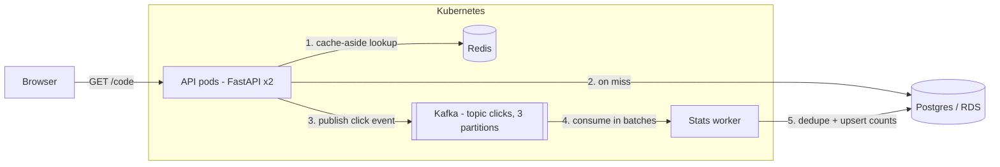
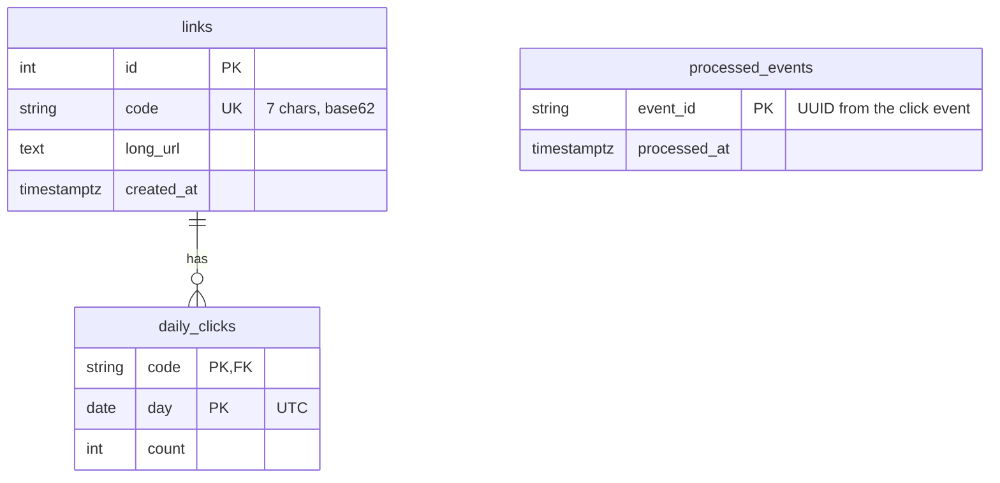
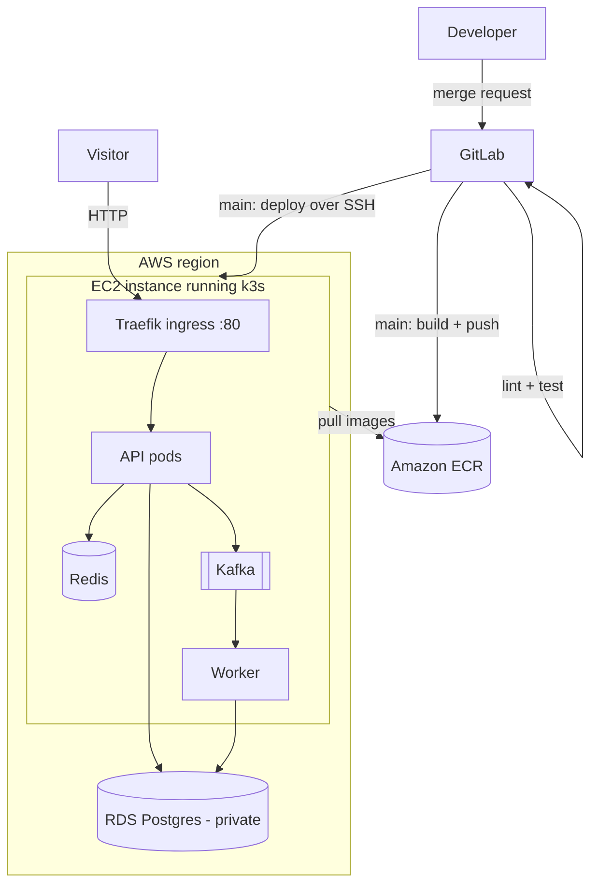

# Architecture

LinkPulse is two programs (the API and the stats worker) built from one codebase, plus three services they depend on. Postgres is the only one the system cannot live without.



## Components

| Part | Role | If it goes down |
| --- | --- | --- |
| API (FastAPI) | Answers every request; publishes click events | Nothing works for users |
| Postgres | Stores links and click counts permanently | New links fail; links already cached in Redis still redirect |
| Redis | Caches redirects (1-hour TTL) and rate-limit counters | Everything works, just slower; rate limiting is skipped |
| Kafka | Ordered, replayable log of click events | Redirects work; events wait in the producer's memory, and a long outage loses them |
| Worker | Turns click events into daily counts | Counting pauses, then catches up from Kafka |

## Code map

| File | Job | Used by |
| --- | --- | --- |
| `api/main.py` | Creates the app and all routes | uvicorn |
| `api/config.py` | Reads settings from environment variables into one `settings` object | almost everything |
| `api/db.py` | Connection pool (`engine`) and per-request sessions (`get_db`) | API, worker, migrations, tests |
| `api/models.py` | Tables: `links`, `daily_clicks`, `processed_events` | API, worker, Alembic |
| `api/schemas.py` | Request and response shapes (Pydantic) | API |
| `api/cache.py` | Redis reads/writes that never raise | API, rate limiter |
| `api/rate_limit.py` | Fixed-window limiter for `POST /links` | API (as a dependency) |
| `api/events.py` | Async Kafka producer | API |
| `api/codes.py` | Random 7-character base62 codes | API |
| `api/timing.py` | `@timed` decorator for latency logs | API |
| `worker/main.py` | Kafka consumer loop, dedupe and upsert | worker container |
| `migrations/` | Alembic schema history | migrate Job |

Only `db.py`, `cache.py` and `events.py` talk to outside services. Everything else is plain Python, which is what lets the tests swap those three edges for fakes.

## Request flows

| User action | What happens | Response |
| --- | --- | --- |
| Create a link (`POST /links`) | Rate limit checked in Redis, URL validated, row inserted in Postgres (retry on code collision) | 201 with `short_url` |
| Click a link (`GET /{code}`) | Look up in Redis, fall back to Postgres on a miss and cache it, publish a click event to Kafka | 307 redirect |
| (background) | Worker reads events, skips already-processed IDs, adds new clicks to `daily_clicks` | none |
| View stats (`GET /links/{code}/stats`) | Read daily counts from Postgres | JSON with total and per-day counts |
| Health checks | `/health` returns OK if the process responds; `/ready` runs `SELECT 1` | 200, or 503 when not ready |

The redirect is answered immediately and counted about a second later (eventual consistency). That split keeps the path users wait on fast.

## Data model



- `links.code` has a unique index: it guarantees uniqueness and makes the redirect lookup fast.
- `daily_clicks` has a composite primary key `(code, day)`, which is what makes `INSERT ... ON CONFLICT DO UPDATE` possible.
- `processed_events` lets the worker ignore events it has already counted.

## The click event

Published by `api/events.py` to the `clicks` topic, keyed by `code` so all clicks for one link land in the same partition, in order:

```json
{
  "event_id": "5b6a1c2e-...",
  "code": "aB3xK9q",
  "ts": "2026-11-02T00:15:16.736636+00:00",
  "user_agent": "Mozilla/5.0 ..."
}
```

Producer settings: `acks=all`, `enable.idempotence=true`, `linger.ms=5`. `produce()` only buffers the event; a background thread sends it, so the redirect never waits on Kafka.

## Delivery guarantees

- The worker uses manual offset commits (`enable.auto.commit=false`).
- For each batch, inside one database transaction: insert every `event_id` into `processed_events` with `ON CONFLICT DO NOTHING ... RETURNING`, count only the new ones, upsert `daily_clicks`.
- Offsets are committed only after that transaction commits.
- If the worker crashes in between, Kafka redelivers the batch, and the dedupe table makes the replay harmless.

Result: at-least-once delivery with idempotent processing. Rewinding the consumer group and replaying the whole topic leaves the counts unchanged.

## Failure handling

- Redis calls have a 0.5 s timeout and return "miss" on error.
- The rate limiter fails open: if Redis is down, requests are allowed.
- Kafka publish errors are logged, never raised to the user.
- `/health` (liveness) has no dependencies, so a database outage does not cause restart loops. `/ready` (readiness) checks Postgres, so pods leave the Service until the database is back.
- The API flushes buffered events on shutdown (FastAPI `lifespan`). The worker handles SIGTERM by finishing its batch and committing.

## Where it runs

| | Local (Compose) | Local Kubernetes (kind) | AWS |
| --- | --- | --- | --- |
| API, worker | containers | Deployments | Deployments on k3s (EC2) |
| Postgres | container | Deployment + PVC | RDS |
| Redis, Kafka | containers | Deployments | Deployments on k3s |
| Migrations | one-shot service | Job | Job (run by CI) |
| Entry point | localhost:8000 | `kubectl port-forward` | Traefik Ingress on port 80 |
| Image | built locally | `kind load` | ECR, tagged with commit SHA |


