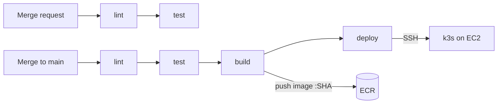

# CI/CD

The pipeline lives in `.gitlab-ci.yml` and runs on GitLab's shared runners.

## When pipelines run

`workflow: rules` decides:

1. A merge request exists: run a merge request pipeline.
2. A branch has an open merge request: skip the separate branch pipeline (no duplicates).
3. Otherwise: run for any branch push, including `main` after a merge.

| Job | Merge requests | `main` |
| --- | --- | --- |
| lint | yes | yes |
| test | yes | yes |
| build | no | yes, if AWS variables are set |
| deploy | no | yes, if AWS variables are set |

build and deploy run only when `ECR_REGISTRY` and `EC2_HOST` exist. Without AWS (a fresh fork, or after tearing AWS down) `main` pipelines run lint and test only and stay green. Add the variables (see [configuration.md](configuration.md#gitlab-cicd-variables-aws-deploys)) and the next merge deploys.

## Jobs

### lint

`ruff check .` and `ruff format --check .`. Runs first because it fails in seconds.

### test

pytest against a real `postgres:17` service container (hostname `postgres`). The job's variables configure both the service (`POSTGRES_*`) and the app (`DATABASE_URL`, `TEST_DATABASE_URL`, `REDIS_URL`). Redis and Kafka are faked inside the tests, so they aren't needed. Results are uploaded as a JUnit report and shown on the merge request.

The pip cache is keyed on `requirements-dev.txt`, so it resets when dependencies change.

### build (main only)

Docker-in-Docker (`docker:27` with the `docker:27-dind` service):

1. Installs the AWS CLI and logs Docker in to ECR.
2. Builds with `--build-arg APP_VERSION=$CI_COMMIT_SHORT_SHA`.
3. Pushes `$ECR_REGISTRY/linkpulse:$CI_COMMIT_SHORT_SHA`.

Runners are amd64, matching EC2, so no `--platform` flag is needed.

### deploy (main only)

Runs in `alpine:3` with the AWS CLI, an SSH client and kubectl (used only to generate YAML locally):

1. Writes `known_hosts` from `SSH_KNOWN_HOSTS` (host key pinning) and prepares `SSH_PRIVATE_KEY`.
2. Sets `newTag` in `k8s/overlays/aws/kustomization.yaml` to the commit SHA (inside the job only, git is not changed).
3. Generates a fresh `ecr-pull` Secret with `--dry-run=client` and applies it over SSH.
4. Deletes the previous `migrate` Job (Jobs are immutable).
5. Renders the overlay with `kubectl kustomize` and pipes it to `sudo k3s kubectl apply -f -` over SSH.
6. Waits for the migration Job, then for the API and worker rollouts (3 minutes each).
7. Smoke test: `curl -fsS http://$EC2_HOST/health`.

The job registers the `production` environment (Operate > Environments), with each deployment listed and a link to the app.

## Safety properties

- Image tags are commit SHAs, so `/health` tells you exactly which commit is live, and rollbacks target an exact build.
- AWS and SSH variables are Protected: merge request pipelines never receive them, so unreviewed code can't reach AWS.
- `main` is protected and "Pipelines must succeed" is on: the only way into `main` is a reviewed merge request with a green pipeline.
- The API Deployment uses `maxUnavailable: 0`, so a broken release stalls instead of causing an outage, and the deploy job fails visibly.
- The CI IAM user can only push and pull one ECR repository. The CI SSH key is separate from personal keys and can be revoked on its own.

## Rolling back

- From GitLab: Operate > Environments > production > re-deploy an earlier deployment. This reruns that commit's deploy job.
- Emergency, from a terminal: `kubectl rollout undo deployment/api` (and `deployment/worker`).

## Validating changes to the pipeline

- Build > Pipeline editor shows syntax errors and lets you simulate which jobs would run.
- Quote any script line that contains `: `, e.g. `- 'sed -i "s/newTag: .*/newTag: $SHA/" file'`.

## Variables

See [configuration.md](configuration.md#gitlab-cicd-variables-aws-deploys).
